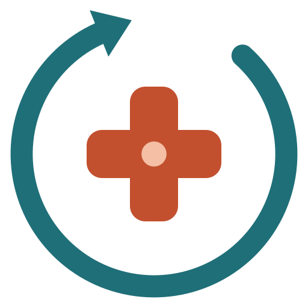

# BuscaLoop Saúde

Pacientes, colegas e campanhas, do primeiro contato ao tratamento, com ética e método. Para **médicos, psiquiatras, dentistas, psicólogos, fisioterapeutas e clínicas multiprofissionais**. Funciona com o **Claude gratuito ou com assinatura** (Pro ou Max) e, se você quiser, com a API da Anthropic.

O BuscaLoop Saúde mantém a lógica do [BuscaLoop](https://github.com/jordanrizetto-design/Otimizador-de-Oportunidades) original:
- um perfil base que alimenta todas as ferramentas;
- um funil por etapa;
- prompts personalizados;
- um ritual semanal.

Muda o objeto: em vez de vagas, pacientes, colegas e campanhas.

É uma **página estática**: um único `index.html`, sem backend, sem cadastro e sem instalação. Você abre no navegador, preenche formulários curtos e recebe prompts prontos para colar no Claude. O rastreador, o briefing e o playbook são montados no próprio navegador.

> Não substitui a orientação do seu conselho profissional nem assessoria jurídica. As regras de publicidade resumidas aqui foram conferidas em outubro de 2026; confirme a norma vigente antes de campanhas e formatos novos.

## Como funciona

1. **Comece aqui**, em três passos:
   1. **Qual resultado você quer alcançar?** Objetivo dos próximos 90 dias e uma frase concreta.
   2. **Configure seu consultório.** Tipo de profissional, registro, especialidade, cidade e bairro.
   3. **Perfil do consultório.** Serviços, público ideal, transformação, baldes de conteúdo, canais, tempo disponível e diferenciais.
2. **Hoje**, no topo da página, mostra três coisas:
   - a próxima ação recomendada;
   - os próximos passos vencidos (pacientes e colegas);
   - a semana: conteúdos publicados contra a meta, contatos, agendados e tratamentos iniciados.
3. **Conflitos são sinalizados.** Por exemplo, um objetivo que menciona "preço promocional" num perfil de dentista, ou atender online sem o atendimento online marcado. O mesmo aviso aparece ao gerar um prompt com termos que o conselho restringe.
4. **Decisões guardadas viram contexto.** O que você aprovar numa ferramenta (ICP, persona, tom de voz, nicho, pautas, roteiros de atendimento) entra nos próximos prompts, no briefing, no arquivo do Projeto e no playbook.

O tipo de profissional define as regras do conselho embutidas em todos os geradores e a ordem recomendada das ferramentas.

## As 17 ferramentas

| # | Ferramenta | O que faz |
|---|---|---|
| 01 | Público, ICP e persona do paciente | Público-alvo, ICP, anti-ICP, personas, mapa de empatia, jornada e perguntas de busca |
| 02 | Persona do profissional e marca | Arquétipo, adjetivos, tom de voz "faço / não faço", bios, história, bandeiras e limites |
| 03 | Nicho e diferencial | Ikigai, três opções de nicho, proposta de valor, diferenciais verificáveis e pesquisa de concorrentes |
| 04 | Perfis e presença | Auditoria e reescrita de Instagram, Perfil da Empresa no Google, YouTube e LinkedIn |
| 05 | Pautas e palavras-chave | Banco de dúvidas reais (fica salvo), palavras-chave por serviço e cidade, 30 pautas, frequência e calendário |
| 06 | Roteiros de conteúdo e copy | Reels, carrosséis, Stories, YouTube, LinkedIn, legendas, páginas, Google e lista de transmissão, com checagem ética |
| 07 | Formação e autoridade | Congressos, cursos, publicações e títulos, e como comunicá-los |
| 08 | Gerador de campanhas | Ficha da campanha, quatro modelos, peças, anúncios Meta e Google, calendário e medição; registro das campanhas com resultados vindos do rastreador |
| 09 | Rede de colegas | Funil de colegas, carta de apresentação, modelo de contrarreferência e agradecimentos |
| 10 | Atendimento e agendamento | Respostas rápidas, roteiro de agendamento, régua de confirmação, retomadas e plano de tratamento compreensível |
| 11 | Rastreador de pacientes | Funil de sete etapas, consentimento por finalidade, próximos passos vencidos, atividades, lembretes (.ics), planilha (.csv) e "Da conversa ao registro" |
| 12 | Assistente da semana | Importa pendências anonimizadas e monta a agenda em blocos |
| 13 | Painel e diagnóstico | Métricas de 8 semanas, diário de conteúdo, gargalo do funil e diagnóstico com IA |
| 14 | Verificador ético | Regras do conselho, LGPD e políticas da Meta e do Google; checagem rápida sem IA e revisão frase a frase |
| 15 | Briefing para terceiros | Documento para agência, social media, videomaker, tráfego, designer, redator ou recepção |
| 16 | Ferramentas recomendadas | Uma ferramenta por necessidade (listadas, não avaliadas) e prompt para montar a sua caixa |
| 17 | Playbook da clínica | E-book com perfil, decisões, regras, funil, campanhas, colegas, métricas, plano de ação, plano de 90 dias e rotina quinzenal |

## Rastreador de pacientes

As sete etapas do rastreador:

| Etapa | Quando |
|---|---|
| Novo | Primeiro contato |
| Em conversa | Troca de mensagens em andamento |
| Agendado | Consulta ou avaliação marcada |
| Avaliado | Compareceu à avaliação |
| Plano proposto | Recebeu o plano de tratamento |
| Em tratamento | Iniciou o tratamento |
| Encerrado | Com resultado (Alta e vínculo, Perdido ou Pausado) e motivo |

**Campos de cada contato:**
- nome ou apelido, telefone e canal preferido;
- origem (inclusive campanhas registradas e indicação de colega), serviço e profissional;
- etapa, próximo passo e data;
- valor do plano;
- consentimento por finalidade (atendimento, lembretes, conteúdos), com data e revogação;
- histórico de atividades (mensagem, ligação, confirmação, retomada), com responsável.

**Requisitos de saúde atendidos:**
1. **Nenhum dado clínico no CRM.** O campo de observações avisa quando o texto parece informação clínica, e os prompts nunca levam nomes ou telefones: no Assistente da semana os pacientes viram "Contato 1, 2…", e em "Da conversa ao registro" telefones, e-mails e CPF são trocados por marcadores.
2. **Consentimento registrado por finalidade**, com opção de revogar.
3. **Regras do conselho embutidas em todos os geradores**, conforme o tipo de profissional. Clínica multiprofissional carrega as regras de cada conselho e usa a mais restritiva nas peças institucionais. Psiquiatria e psicologia incluem cuidados de comunicação em saúde mental (CVV 188 em temas de suicídio).

## Regras de publicidade resumidas (outubro de 2026)

| Conselho | Norma | Fontes |
|---|---|---|
| CFM | Resolução CFM nº 2.336/2023 | [Migalhas](https://www.migalhas.com.br/quentes/393424/cfm-muda-regra-e-permite-antes-e-depois-de-pacientes-na-internet), [CRM-PR](https://crmpr.org.br/uploadAddress/Publicidade-medica-apresentacao-coletiva-12-09-(1)[6052].pdf) |
| CFO | Código de Ética Odontológica, com alterações da Res. CFO 271/2025, e orientações do CRO | [CROSP](https://site.crosp.org.br/uploads/arquivo/3724579826b71ed53e3c7d0ff3104a64.pdf), [Res. CFO 271/2025](https://sistemas.cfo.org.br/visualizar/atos/RESOLU%C3%87%C3%83O/SEC/2025/271), [LegisMap](https://legismap.com.br/conteudos/artigos-e-noticias/em-cumprimento-a-decisao-do-cade-cfo-realiza-alteracoes-pontuais-no-codigo-de-etica) |
| CFP | Código de Ética do Psicólogo (art. 20), Res. CFP 3/2007 e Nota Técnica CFP 1/2022 | [Cartilha CRP-MG, abril de 2026](https://acervodigital.crp04.org.br/wp-content/uploads/tainacan-items/9483/81624/CRP-MG_Cartilha-Publicidade-profissional-abril-2026.pdf), [CFP](https://site.cfp.org.br/cfp-divulga-orientacoes-a-categoria-sobre-publicidade-nas-redes-sociais/) |
| COFFITO | Código de Ética e Deontologia da Fisioterapia (Res. COFFITO 424/2013) | [Normas Brasil](https://www.normasbrasil.com.br/norma/resolucao-424-2013_257114.html) |

## Três modos de uso

O modo fica em **Configurações → Como você usa a IA**. O padrão é o Claude gratuito.

| Modo | Como funciona | Custo |
|---|---|---|
| Claude gratuito | A página gera o prompt; você copia e cola no Claude.ai | Grátis, com limite de mensagens |
| Claude Pro ou Max | Prompts mais completos; nas ferramentas que pesquisam na web, a página lembra de ativar o Research | Sua assinatura |
| API da Anthropic | "Gerar resposta aqui (API)" mostra a resposta na página, com fontes, custo, pedido de ajustes e o botão "Guardar como versão final" | Pago por uso, à parte da assinatura |

No modo API, o prompt e a sua chave vão do navegador direto para a API da Anthropic. Por padrão a chave não fica salva, e ela nunca entra no backup.

**Projeto no Claude.ai** (funciona também no plano gratuito): copie as instruções e baixe o arquivo `buscaloop-saude-consultorio.md`. Ele traz o perfil do consultório, as regras do conselho, as decisões guardadas e as contagens da semana, sem nomes de pacientes.

## Para onde vão seus dados

| Situação | Para onde vão os dados |
|---|---|
| Preencher o perfil, registrar pacientes, colegas, campanhas e conteúdos, gerar briefing e playbook | Ficam neste navegador. Não há servidor nem banco de dados |
| Gerar um prompt | É montado na página e nunca inclui nomes ou telefones do rastreador |
| Colar o prompt no Claude.ai | Vai para a Anthropic, sob a sua conta e as regras de privacidade do Claude.ai |
| Modo API | O prompt e a sua chave vão do navegador para a API da Anthropic |
| Abrir a página | O GitHub Pages e o Google Fonts recebem o endereço IP e dados técnicos, como em qualquer site |
| Trocar de computador ou celular | Os dados não vão junto. Use o backup |

## Backup e restauração

Em **Configurações → Seus dados**:
- **Fazer backup (.json)** baixa tudo, menos a chave da API. O arquivo contém nomes e telefones de pacientes: guarde em local seguro.
- **Restaurar backup** valida e higieniza o arquivo antes de aplicar, e pede confirmação.
- **Apagar meus dados deste navegador** limpa tudo.

O painel Hoje lembra de fazer backup quando há dados e nenhum backup nos últimos 14 dias.

## Limites desta versão

Esta versão cobre o MVP e a v2 do roteiro: tudo o que funciona numa página no navegador.

Ficam para uma versão com servidor (v3):
- vários usuários com perfis de acesso (profissional, coordenação, recepção);
- integração com WhatsApp Business e agenda (Google ou Outlook);
- importação de conversões offline para Meta e Google.

Uma clínica com recepção e dados compartilhados vai precisar dessa versão, com as obrigações da LGPD que ela traz.

## Como publicar no GitHub Pages

1. No GitHub, crie um repositório **público** (por exemplo `buscaloop-saude`), sem README.
2. Em **Add file → Upload files**, envie `index.html`, `README.md`, `LICENSE` e `buscaloop-saude-logo.svg` e clique em **Commit changes**.
3. Em **Settings → Pages**, escolha **Deploy from a branch**, branch **main**, pasta **/ (root)**, e salve.
4. Em 1 a 2 minutos o site fica em `https://SEU-USUARIO.github.io/NOME-DO-REPOSITORIO/`.
5. Para mostrar o link do GitHub no menu e no rodapé, preencha `REPO_URL` em `src/app1.js` e rode `python3 build.py`, ou edite a constante `REPO_URL` direto no `index.html`.

## Como usar (para quem nunca usou IA)

1. Entre em [claude.ai](https://claude.ai) com uma conta gratuita (só e-mail).
2. No BuscaLoop Saúde, clique em **"Começar: defina seu objetivo"**, preencha os três passos e clique em **"Ver minha próxima ação"**.
3. Siga o painel **Hoje**: abra a ferramenta indicada, preencha e clique em **"Gerar prompt"**.
4. Clique em **"Copiar prompt"**, cole no Claude e envie. Peça ajustes na mesma conversa.
5. Cole a versão final em **"Guardar a versão final"**, na própria ferramenta.
6. Registre cada novo contato no **Rastreador** e cada conteúdo no **Diário**.
7. Toda segunda, use o **Assistente da semana**. A cada 2 semanas, gere o **Playbook**.

## Para desenvolvedores

O código-fonte fica em `src/`:
- `config_part.html`, `settings_part.html`, `tools.html`, `body2.html` e `head_part.html`;
- `app1.js` a `app4.js`;
- `extra.css` e `base.css`.

O `python3 build.py` junta tudo em `index.html`. As regras dos conselhos ficam em `COUNCILS`, os tipos de profissional em `PROFISSIONAIS`, as prioridades em `OBJETIVOS` e `PROF_ROTA`, e os prompts em `promptBuilders`.

## Licença

MIT. Veja [LICENSE](./LICENSE).
