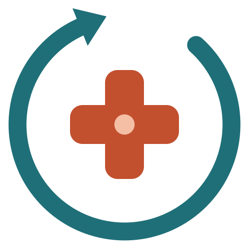

# CliniLoop

**Guia digital: o e-book _Prompt do Sim · Saúde_, de JR Tosoni, mais o app CliniLoop.** Pacientes, colegas e campanhas, do primeiro contato ao tratamento, com ética e método. Para **médicos, psiquiatras, dentistas, psicólogos, fisioterapeutas, nutricionistas e clínicas multiprofissionais**. Funciona com o **Claude gratuito ou com assinatura** (Pro ou Max) e, se você quiser, com a API da Anthropic.

O CliniLoop mantém a lógica do [BuscaLoop](https://github.com/jordanrizetto-design/Otimizador-de-Oportunidades) original:
- um perfil base que alimenta todas as ferramentas;
- um funil por etapa;
- prompts personalizados;
- um ritual semanal.

Muda o objeto: em vez de vagas, pacientes, colegas e campanhas.

É uma **página estática**: um único `index.html`, sem backend, sem cadastro e sem instalação. Você abre no navegador, preenche formulários curtos e recebe prompts prontos para colar no Claude. O rastreador, o briefing e o playbook são montados no próprio navegador.

> Não substitui a orientação do seu conselho profissional nem assessoria jurídica. As regras de publicidade resumidas aqui foram conferidas em outubro de 2026; confirme a norma vigente antes de campanhas e formatos novos.

## Novidades desta versão (beta)

- **Modo guiado**: por padrão o app mostra só as ferramentas que mais ajudam agora (de 3 a 4) e deixa as 18 a um clique.
- **Primeiro ganho**: um passo a passo curto leva da configuração ao prompt do perfil.
- **Instalável e offline**: funciona como aplicativo no celular e no computador (PWA).
- **Feedback de teste** dentro do app, sem dados de pacientes.
- Documentos para validar o produto: [roteiro de teste com profissionais](docs/ROTEIRO_DE_TESTE.md) e [checklist de revisão jurídica](docs/CHECKLIST_REVISAO_JURIDICA.md).

> Estado real: o CliniLoop **ainda não foi testado com profissionais de saúde** nem revisado por advogado. Não há casos de uso nem depoimentos, e nenhum foi inventado.

## O livro e o app

O e-book _Prompt do Sim · Saúde_ ensina o roteiro; o CliniLoop guarda o registro. O livro tem **seis etapas e 14 partes**, e cada parte termina em três caixas: **Prompt do Sim** (o prompt pronto), **Na prática** (o passo de até 30 minutos para hoje) e **Sinergia CliniLoop** (a ferramenta do app).

| Etapa do livro | Partes | Ferramentas do CliniLoop |
|---|---|---|
| 1. Entenda o jogo e as regras | 1 A jornada do Sim na saúde · 2 Ética primeiro: conselhos e LGPD | Comece aqui, Painel (os sete sins), Verificador ético |
| 2. Posicione-se | 3 Os canais, um a um | Perfis e presença (com checklist de cada canal), Público, Persona do profissional, Nicho (Oceano Azul), Formação |
| 3. Gere autoridade e demanda | 4 Conteúdo · 5 Reaproveitamento · 6 Colegas · 7 Tráfego pago | Pautas, Roteiros, Reaproveitamento de conteúdo, Rede de colegas, Gerador de campanhas (com impulsionamento) |
| 4. Converta contatos em consultas | 8 Agendamento · 9 Comparecimento | Atendimento e agendamento, Rastreador de pacientes |
| 5. Feche e acompanhe o tratamento | 10 Fechamento com ética | Plano de tratamento compreensível, Rastreador, Assistente da semana |
| 6. Meça e escale com CRM | 11 CRM · 12 Especificação do app · 13 Campanhas e prompts · 14 Ferramentas | Rastreador, Painel, Playbook, Gerador de campanhas, Verificador ético, Ferramentas recomendadas |

No app, a integração aparece em três lugares:
- **Faixa "No livro" em cada ferramenta:** a parte e a etapa correspondentes, o passo "Na prática" e o prompt do livro já preenchido com o Perfil do consultório (copiar ou abrir direto no Claude).
- **Seção "O livro":** o roteiro em seis etapas com o que você já usou, os sete sins com os números dos últimos 30 dias, a biblioteca com os 12 prompts da Parte 13, a estrutura de um bom prompt, as quatro regras de IA e o glossário de 75 termos (Anexo A).
- **Comportamento do app alinhado ao livro:** próximo passo típico de cada etapa, planos sem decisão em 2, 7 e 15 dias, retomadas de 1, 3 e 7 dias, faltas registradas e mostradas por dia da semana, métricas da Parte 11 (taxas de agendamento, comparecimento, aceitação e conclusão, custo por paciente que compareceu, indicações por colega, receita por origem), funil de colegas do livro (Mapeado, Apresentado, Primeira indicação, Parceiro ativo, Inativo) e o ritual semanal de 30 minutos no Assistente e no Playbook.

## O método por trás

| Base | Autoria | O que entra no CliniLoop |
|---|---|---|
| Prompt do Sim · Saúde | JR Tosoni | O e-book que o app acompanha: seis etapas, sete sins, três caixas por parte e as quatro regras de IA (não invente, revise sempre, proteja dados, mantenha a sua voz). |
| Oceano Azul | W. Chan Kim e Renée Mauborgne | As quatro ações (eliminar, reduzir, elevar, criar) para uma proposta de valor própria e ética. |
| Método Foguete | Pat Machadu | Sete etapas de crescimento: fundamentos, planejamento (transformação, adjetivos de marca, temas de conteúdo), perfil, produção, análise, recursos da plataforma e metas S.M.A.R.T. Criado para o YouTube e adaptado ao Instagram. |
| Efeito Di | Diandra Santos (@segueadi) | Inteligência de nicho, uma promessa e uma pergunta por peça, quadros e personagens recorrentes, biblioteca de formatos (tela dividida, tela verde, Lo-Fi, quadro a quadro, ranking com critério), marca pessoal, gravação no celular, confiança na câmera, revisão de roteiro em duas etapas, impulsionamento e o R.O.A.S. (Roteiro, Observação, Adaptação, Substituição) para modelar referências sem copiar. |
| Reaproveitamento | Thiago Lemos e Alexandre Abramo | Uma aula, podcast ou entrevista vira carrossel, guia, Reel e Stories, com registro de ideias, autoria e pendências. |
| Pesquisa e normas | out/2026 | Sinais do algoritmo do Instagram (tempo de visualização, envios por alcance e curtidas por alcance confirmados pela Meta; o resto é heurística) e regras do CFM, CFO, CFP, COFFITO e CFN. |

O CliniLoop usa princípios dessas fontes e não reproduz o material dos cursos. Rótulos pedagógicos como "viciante" não são métricas, e o R.O.A.S. do curso não é o ROAS de mídia paga.

**Fluxo de cada peça:** ideia → roteiro → revisão editorial → revisão clínica e ética → gravação → revisão final → publicação → análise.

**Princípios embutidos em todos os prompts:**
- não prometer alcance, seguidores ou viralização;
- separar princípio de método, adaptação, observação, informação clínica validada e hipótese, marcando afirmação clínica sem fonte como pendente de validação;
- não usar medo, escassez ou vergonha para vender;
- nunca apresentar imagem gerada como paciente real;
- não diagnosticar por comentário, foto ou vídeo.

## Como funciona

1. **Comece aqui**, em três passos:
   1. **Qual resultado você quer alcançar?** Objetivo dos próximos 90 dias e uma frase concreta.
   2. **Configure seu consultório.** Tipo de profissional, registro, tipo de conta (profissional ou clínica), especialidade, cidade e bairro.
   3. **Perfil do consultório.** Serviços, público ideal, proposta de valor, temas de conteúdo (com a sugestão do livro para a sua profissão), canais, tempo disponível e diferenciais.
2. **Hoje**, no topo da página, mostra três coisas:
   - a próxima ação recomendada;
   - os próximos passos vencidos (pacientes e colegas);
   - a semana: conteúdos publicados contra a meta, contatos, agendados e tratamentos iniciados.
3. **Conflitos são sinalizados.** Por exemplo, um objetivo que menciona "preço promocional" num perfil de dentista, ou atender online sem o atendimento online marcado. O mesmo aviso aparece ao gerar um prompt com termos que o conselho restringe.
4. **Decisões guardadas viram contexto.** O que você aprovar numa ferramenta (ICP, persona, tom de voz, nicho, pautas, roteiros de atendimento) entra nos próximos prompts, no briefing, no arquivo do Projeto e no playbook.

O tipo de profissional define as regras do conselho embutidas em todos os geradores e a ordem recomendada das ferramentas.

## As 18 ferramentas

| # | Ferramenta | Parte do livro | O que faz |
|---|---|---|---|
| 01 | Público, ICP e persona do paciente | 3 | Público-alvo, ICP, anti-ICP, personas, mapa de empatia, jornada e perguntas de busca |
| 02 | Persona do profissional e marca | 3 | Arquétipo, adjetivos, tom de voz "faço / não faço", bios, história, bandeiras e limites |
| 03 | Nicho e diferencial | Apresentação e 3 | Oceano Azul, três opções de nicho, proposta de valor, diferenciais verificáveis e pesquisa de concorrentes |
| 04 | Perfis e presença | 3 | Auditoria e reescrita de Google, Instagram, YouTube, LinkedIn e TikTok, checklist de configuração de cada canal e assistente da página da bio |
| 05 | Pautas e palavras-chave | 4 | Banco de dúvidas reais, palavras-chave por serviço e cidade, 30 pautas por momento da jornada, quadros recorrentes, metas S.M.A.R.T., frequência do livro e calendário |
| 06 | Roteiros de conteúdo e copy | 4 | Reel em seis tempos, carrosséis, Stories, YouTube, LinkedIn, legendas e páginas; quadro recorrente, R.O.A.S., revisão em duas etapas, checklist antes de publicar e referências de criadores clínicos |
| 07 | Reaproveitamento de conteúdo | 5 | Da aula, podcast ou entrevista ao carrossel, guia, Reel em duas versões e Stories, com registro de ideias e pendências |
| 08 | Formação e autoridade | 3 | Congressos, cursos, publicações e títulos, e como comunicá-los |
| 09 | Gerador de campanhas | 7 e 13 | Campanha completa, plano de impulsionamento (Turbinar) ou só anúncios Meta e Google; registro de campanhas e impulsionamentos com custo por paciente que compareceu |
| 10 | Rede de colegas | 6 | Quem indica quem, funil de colegas do livro, carta de apresentação, contrarreferência e agradecimentos |
| 11 | Atendimento e agendamento | 8 e 10 | 12 respostas rápidas, agendamento em cinco mensagens, sequência de confirmação, retomadas e plano de tratamento compreensível |
| 12 | Rastreador de pacientes | 9 e 11 | Funil de sete etapas, consentimento por finalidade, próximo passo típico, planos parados, faltas, lembretes (.ics), planilha (.csv) e "Da conversa ao registro" |
| 13 | Assistente da semana | 10 e 11 | Ritual de 30 minutos: pendências anonimizadas, parados e agenda em blocos |
| 14 | Painel e diagnóstico | 11 e 1 | Métricas de 8 semanas, métricas da Parte 11 por origem e profissional, faltas por dia da semana, diário de conteúdo, gargalo e diagnóstico com IA |
| 15 | Verificador ético | 2 e 13 | Regras do conselho, LGPD e políticas da Meta e do Google; checagem rápida sem IA e revisão frase a frase |
| 16 | Briefing para terceiros | 14 | Documento para agência, social media, videomaker, tráfego, designer, redator ou recepção |
| 17 | Ferramentas recomendadas | 14 | Uma ferramenta por necessidade (listadas, não avaliadas) e prompt para montar a sua caixa |
| 18 | Playbook da clínica | 11 | E-book com o livro e os sete sins, perfil, decisões, regras, funil, campanhas, colegas, métricas, plano de ação, 90 dias e ritual |

## Rastreador de pacientes

As sete etapas do rastreador:

| Etapa | Quando |
|---|---|
| Novo | Primeiro contato |
| Em conversa | Troca de mensagens em andamento |
| Agendado | Consulta ou avaliação marcada |
| Avaliado | Compareceu à avaliação |
| Plano proposto | Recebeu o plano de tratamento |
| Em tratamento | Iniciou o tratamento |
| Encerrado | Com resultado (Alta e vínculo, Perdido ou Pausado) e motivo |

Para médicos, psiquiatras e psicólogos sem planos por pacote, as etapas 5 e 6 aparecem como "Retorno agendado" e "Em acompanhamento", como na Parte 11 do livro.

**Campos de cada contato:**
- nome ou apelido, telefone e canal preferido;
- origem (inclusive campanhas registradas e indicação de colega), serviço e profissional;
- etapa, próximo passo e data;
- valor do plano;
- consentimento por finalidade (atendimento, lembretes, conteúdos), com data e revogação;
- histórico de atividades (mensagem, ligação, confirmação, retomada, falta, remarcação), com responsável.

**Requisitos de saúde atendidos:**
1. **Nenhum dado clínico no CRM.** O campo de observações avisa quando o texto parece informação clínica, e os prompts nunca levam nomes ou telefones: no Assistente da semana os pacientes viram "Contato 1, 2…", e em "Da conversa ao registro" telefones, e-mails e CPF são trocados por marcadores.
2. **Consentimento registrado por finalidade**, com opção de revogar.
3. **Regras do conselho embutidas em todos os geradores**, conforme o tipo de profissional. Clínica multiprofissional carrega as regras de cada conselho e usa a mais restritiva nas peças institucionais. Psiquiatria e psicologia incluem cuidados de comunicação em saúde mental (CVV 188 em temas de suicídio).

## Regras de publicidade resumidas (outubro de 2026)

| Conselho | Norma | Fontes |
|---|---|---|
| CFM | Resolução CFM nº 2.336/2023 (revogou 1.974/2011, 2.126/2015 e 2.133/2015) | [Texto oficial](https://sistemas.cfm.org.br/normas/arquivos/resolucoes/BR/2023/2336_2023.pdf), [Migalhas](https://www.migalhas.com.br/quentes/393424/cfm-muda-regra-e-permite-antes-e-depois-de-pacientes-na-internet) |
| CFO | Código de Ética Odontológica (alterado pela Res. CFO 271/2025) e Res. CFO 196/2019 (antes e depois: só pelo dentista que executou, nunca no perfil da clínica) | [FAQ do CFO sobre a 196/2019](https://website.cfo.org.br/resolucao-cfo-196-2019/), [CROSP](https://site.crosp.org.br/uploads/arquivo/3724579826b71ed53e3c7d0ff3104a64.pdf), [Res. CFO 271/2025](https://sistemas.cfo.org.br/visualizar/atos/RESOLU%C3%87%C3%83O/SEC/2025/271), [LegisMap](https://legismap.com.br/conteudos/artigos-e-noticias/em-cumprimento-a-decisao-do-cade-cfo-realiza-alteracoes-pontuais-no-codigo-de-etica) |
| CFP | Código de Ética do Psicólogo (art. 20), Res. CFP 3/2007 e Nota Técnica CFP 1/2022 | [Cartilha CRP-MG, abril de 2026](https://acervodigital.crp04.org.br/wp-content/uploads/tainacan-items/9483/81624/CRP-MG_Cartilha-Publicidade-profissional-abril-2026.pdf), [CFP](https://site.cfp.org.br/cfp-divulga-orientacoes-a-categoria-sobre-publicidade-nas-redes-sociais/) |
| COFFITO | Res. COFFITO 532/2021 (publicidade e imagem de pacientes) e Código de Ética da Fisioterapia (Res. 424/2013) | [COFFITO](https://www.coffito.gov.br/nsite/?p=18752), [Normas Brasil](https://www.normasbrasil.com.br/norma/resolucao-424-2013_257114.html) |
| CFN | Código de Ética e de Conduta do Nutricionista (Res. CFN 599/2018), capítulos IV e V | [Res. 599/2018](https://cfn.org.br/wp-content/uploads/resolucoes/Res_599_2018.html), [Código (PDF)](https://www.cfn.org.br/wp-content/uploads/2019/06/Novo_Codigo_de_Etica-e-de-Conduta-do-Nutricionista.pdf) |

## Três modos de uso

O modo fica em **Configurações → Como você usa a IA**. O padrão é o Claude gratuito.

| Modo | Como funciona | Custo |
|---|---|---|
| Claude gratuito | A página gera o prompt; você copia e cola no Claude.ai | Grátis, com limite de mensagens |
| Claude Pro ou Max | Prompts mais completos; nas ferramentas que pesquisam na web, a página lembra de ativar o Research | Sua assinatura |
| API da Anthropic | "Gerar resposta aqui (API)" mostra a resposta na página, com fontes, custo, pedido de ajustes e o botão "Guardar como versão final" | Pago por uso, à parte da assinatura |

No modo API, o prompt e a sua chave vão do navegador direto para a API da Anthropic. Por padrão a chave não fica salva, e ela nunca entra no backup.

**Projeto no Claude.ai** (funciona também no plano gratuito): copie as instruções e baixe o arquivo `cliniloop-consultorio.md`. Ele traz o perfil do consultório, as regras do conselho, as decisões guardadas e as contagens da semana, sem nomes de pacientes.

## Para onde vão seus dados

| Situação | Para onde vão os dados |
|---|---|
| Preencher o perfil, registrar pacientes, colegas, campanhas e conteúdos, gerar briefing e playbook | Ficam neste navegador. Não há servidor nem banco de dados |
| Gerar um prompt | É montado na página e nunca inclui nomes ou telefones do rastreador |
| Colar o prompt no Claude.ai | Vai para a Anthropic, sob a sua conta e as regras de privacidade do Claude.ai |
| Modo API | O prompt e a sua chave vão do navegador para a API da Anthropic |
| Abrir a página | O GitHub Pages e o Google Fonts recebem o endereço IP e dados técnicos, como em qualquer site |
| Trocar de computador ou celular | Os dados não vão junto. Use o backup |

## Backup e restauração

Em **Configurações → Seus dados**:
- **Fazer backup (.json)** baixa tudo, menos a chave da API. O arquivo contém nomes e telefones de pacientes: guarde em local seguro.
- **Restaurar backup** valida e higieniza o arquivo antes de aplicar, e pede confirmação.
- **Apagar meus dados deste navegador** limpa tudo.

O painel Hoje lembra de fazer backup quando há dados e nenhum backup nos últimos 14 dias.

## Limites desta versão

Esta versão cobre o MVP e a v2 da Parte 12 do livro: tudo o que funciona numa página no navegador.

O modelo foi pensado para o profissional que trabalha sozinho: os dados ficam no navegador de quem usa e não são compartilhados. Clínicas em que recepção, coordenação e vários profissionais precisam acessar os mesmos registros precisam de outra solução; escreva para suporte_CliniLoop@gmail.com.

Ficam para a v3: integração com WhatsApp e agenda e importação de conversões offline para Meta e Google.

## Publicação

O app fica em **https://jordanrizetto-design.github.io/CliniLoop/** (GitHub Pages, branch `main`, pasta raiz). Para publicar uma cópia sua: crie um repositório público, envie `index.html`, `README.md`, `LICENSE` e `cliniloop-logo.svg`, e ative **Settings → Pages → Deploy from a branch → main / (root)**. Para mostrar o link do GitHub no menu, preencha `REPO_URL` em `src/app1.js` e rode `python3 build.py`.

## Como usar (para quem nunca usou IA)

1. Entre em [claude.ai](https://claude.ai) com uma conta gratuita (só e-mail).
2. No CliniLoop, clique em **"Começar: defina seu objetivo"**, preencha os três passos e clique em **"Ver minha próxima ação"**.
3. Siga o painel **Hoje**: abra a ferramenta indicada, preencha e clique em **"Gerar prompt"**.
4. Clique em **"Copiar prompt"**, cole no Claude e envie. Peça ajustes na mesma conversa.
5. Cole a versão final em **"Guardar a versão final"**, na própria ferramenta.
6. Registre cada novo contato no **Rastreador** e cada conteúdo no **Diário**.
7. Toda segunda, use o **Assistente da semana**. A cada 2 semanas, gere o **Playbook**.

## Para desenvolvedores

O código-fonte fica em `src/`:
- `config_part.html`, `settings_part.html`, `tools.html`, `livro.html`, `body2.html` e `head_part.html`;
- `app1.js` a `app5.js` e `livro_data.js` (o mapa do livro: etapas, partes, caixas Na prática e Sinergia, os 12 prompts, as checklists e o glossário);
- `extra.css` e `base.css`.

O `python3 build.py` junta tudo em `index.html`. As regras dos conselhos ficam em `COUNCILS`, os tipos de profissional em `PROFISSIONAIS`, as prioridades em `OBJETIVOS` e `PROF_ROTA`, os prompts em `promptBuilders` e o livro em `LIVRO`, `TOOL_PARTES` e `PROMPTS_LIVRO`.

## Licença

MIT. Veja [LICENSE](./LICENSE).
